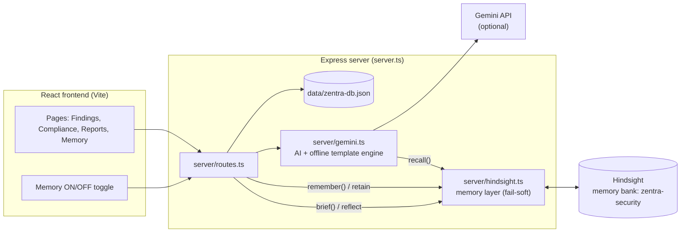

# ZENTRA

**ZENTRA is a zero-trust and compliance platform for network devices and APIs, with an AI analyst that remembers.**

It parses device configs (Cisco, Juniper, Palo Alto, Arista, SONiC and more), scores them against CIS, NIST 800-53, ISO 27001 and DISA STIG, scans APIs for zero-trust gaps, generates vendor-specific CLI fixes, and produces tamper-evident (HMAC-sealed) audit reports. Persistent agent memory comes from [Hindsight](https://github.com/vectorize-io/hindsight) by Vectorize.

## The problem it solves

Security and compliance teams fight the same fires every audit cycle. Findings get closed, risks get accepted for good business reasons, a fix fails because of a vendor quirk, and then the knowledge lives in someone's head or a ticket nobody can find. Next quarter the AI assistant (and the new hire) starts from zero and suggests the same fix that already failed.

ZENTRA gives its AI a memory. It remembers **findings, risk decisions, remediation outcomes and vendor quirks**, and uses them the next time a similar control fails, so recommendations get better with every audit instead of resetting.

## Architecture



Hindsight sits beside the AI engine, not in front of it. Every call is fail-soft: if Hindsight is down or not configured, ZENTRA behaves exactly as it did before.

## Setup

**Prerequisites:** Node.js 20+ and a Hindsight account (Hindsight Cloud, or a self-hosted server).

1. Install dependencies

   ```bash
   npm install
   ```

2. Copy `.env.example` to `.env` and fill it in

   | Variable | Required | What it does |
   | --- | --- | --- |
   | `HINDSIGHT_BASE_URL` | for memory | Hindsight Cloud URL, or your self-hosted URL |
   | `HINDSIGHT_API_KEY` | for Cloud | API key for Hindsight Cloud |
   | `HINDSIGHT_BANK_ID` | for memory | Memory bank id, use `zentra-security` |
   | `GEMINI_API_KEY` | optional | Enables Gemini-written fixes. Without it ZENTRA uses its built-in vendor templates |
   | `ZENTRA_OFFLINE` | optional | `true` keeps AI fully local (templates only) |
   | `DEMO_MODE` | optional | `true` lets requests without a login token act as the Admin demo user. Default: requests without a valid token get HTTP 401 |

   In AI Studio, add the same names in the **Secrets** panel instead.

3. Run

   ```bash
   npm run dev
   ```

   Open http://localhost:3000 and sign in.

The memory bank is created automatically on first start (with the mission "Security compliance analyst memory for this organisation...").

## Load sample memory

```bash
npm run seed:memory        # same as: npx tsx scripts/seed-memory.ts
```

This stores about 25 realistic events spread over the last six months: 6 resolved audit findings, 5 accepted-risk decisions, 6 remediation outcomes (3 of them failures), 4 vendor quirks and 4 analyst teachings. They reference the devices and APIs that ship with ZENTRA (`LEAF01-POD2`, `CORE-CAT9300-SFO`, `PA-3220-EDGE-FW01`, `SRX345-DC-GATEWAY`, `SONIC-SPINE-01`, the Payment Gateway API, and so on). You can also click **Load sample memory** on the Memory page. Hindsight processes memories asynchronously, so wait 30 to 60 seconds before demoing.

## How Hindsight memory is used

### Retain (ZENTRA writes to memory)

All writes go through `remember()` / `rememberBatch()` in `server/hindsight.ts`, are fire-and-forget, and never slow a response.

| Where | File | Memory context | What is stored |
| --- | --- | --- | --- |
| `PUT /api/findings/:id/status` | `server/routes.ts` | `finding-decision` | Who changed which finding from what to what, and the reason for accepted risks |
| `POST /api/compliance/evaluate` | `server/routes.ts` | `compliance-result` | Every failed control: device, vendor, model, control, framework, expected vs found |
| `POST /api/compliance/remediation-cli` | `server/routes.ts` | `remediation-generated` | The generated CLI fix with vendor, control id and hostname |
| `POST /api/training/rules` | `server/routes.ts` | `analyst-teaching` | What the analyst taught the parser |
| `POST /api/apis/:id/scan` | `server/routes.ts` | `scan-summary` | Findings by severity and the change since the last scan |
| `POST /api/remediation/outcome` | `server/routes.ts` | `remediation-outcome` | Whether a fix WORKED or FAILED, and why (the "This fix worked / failed" buttons) |
| `POST /api/memory/seed`, `npm run seed:memory` | `server/memory-seed.ts` | various | The sample history |

### Recall (ZENTRA reads from memory)

| Where | File | What it does |
| --- | --- | --- |
| `generateVendorCliRemediationWithSource()` | `server/gemini.ts` | Recalls past fixes for the vendor + control + hostname. With Gemini they go into the prompt under **RELEVANT PAST EXPERIENCE FROM THIS ORGANISATION** ("prefer what worked, avoid what failed"). In offline/template mode they are added as comment lines above the commands |
| `analyzeApiSecurity()` | `server/gemini.ts` | Same, for API analysis (API name, auth type, environment) |
| `GET /api/memory/recall?q=` | `server/routes.ts` | Powers the **Seen before** card on the finding page |
| `GET /api/memory/brief?target=` | `server/routes.ts` | Hindsight `reflect`: an audit-readiness briefing for a device or API (Memory page) |
| `GET /api/memory/recent` | `server/routes.ts` | Timeline of what ZENTRA sent to memory (a local activity journal, `data/memory-journal.json`) |

Both AI responses carry `memoriesUsed` and `memoryCount`; the UI shows them as a **Used N memories** badge that opens the exact list.

Safety: recalled memories are treated as data, never as instructions. Anything that matches the injection scanner (`server/seal.ts`) is dropped before it reaches a prompt.

### Before and after

Generating a fix for `CIS-NET-1.12` (session idle timeout) on Arista `LEAF01-POD2`:

**Memory OFF**

```
configure
management ssh
 idle-timeout 10
line vty
 timeout login 10
exit
write memory
```

**Memory ON**

```
! ZENTRA MEMORY: 6 relevant past experience(s) from this organisation - review before applying:
! - Remediation of CIS-NET-1.12 on Arista EOS LEAF01-POD2 FAILED. Notes: the SSH idle-timeout change under 'management ssh' did not take effect after 'write memory'. The SSH service had to be restarted ...
! - Finding on LEAF01-POD2 ... CIS-NET-1.12 ... changed from OPEN to ACCEPTED_RISK by Alex Vance (ADMIN) ...
configure
management ssh
 idle-timeout 10
line vty
 timeout login 10
exit
write memory
```

With a Gemini key, the model itself reads those memories and changes the commands (for example, it adds the SSH service restart) instead of just annotating them.

## Demo script (before / after)

1. `npm run seed:memory`, then wait about a minute.
2. Header: switch **Memory OFF**. Go to Audit Reports, preview a device report, and look at the generated fix for a failed control. It is generic, with no history.
3. Switch **Memory ON** and open the same preview. The badge says "Used N memories" and the fix mentions the earlier failure.
4. Click **This fix failed**, add a note, then regenerate a minute later (Hindsight processes new memories asynchronously): the outcome now shapes the answer.
5. Memory page: type `LEAF01-POD2` and click **Get audit briefing**.

## Scripts

| Command | Purpose |
| --- | --- |
| `npm run dev` | Start the server with the Vite dev middleware |
| `npm run build` | Build the frontend |
| `npm start` | Start the server (set `NODE_ENV=production` to serve `dist/`) |
| `npm run lint` | Type-check (`tsc --noEmit`) |
| `npm run seed:memory` | Load sample memory into Hindsight |

See also `README-OFFLINE.md` for running ZENTRA with no cloud AI.
